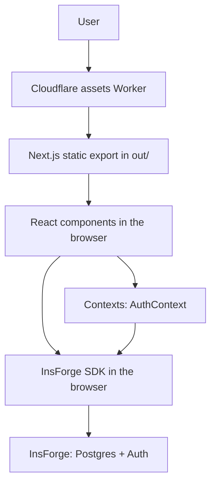

# System architecture

> Design and patterns of TravelPal (repo `PabloJustDevelops/TravelPal`).

## Overview

Next.js web app (App Router) exported as static files and served by Cloudflare Workers Assets,
with InsForge as the backend. In production no Next.js server runs: the UI and authentication work
in the browser and the SDK talks to InsForge directly.

### Stack

| Layer | Technology | Purpose |
|------|------------|-----------|
| Frontend | Next.js 16.3.8 + React 19 | Framework and UI |
| Language | TypeScript | Static typing |
| Styles | Tailwind CSS | Responsive design |
| Backend | InsForge (`@insforge/sdk`) | Postgres + Auth + Storage |
| Hosting | Cloudflare Workers Assets + Wrangler | Serve the static export from `out/` |

### Structure

```
src/
├── app/                  # App Router: pages only, no route handlers
├── components/           # UI by domain (trips, notes, planning, ...)
├── contexts/             # AuthContext, ThemeContext
└── lib/
    ├── insforge.ts       # Browser InsForge client (createInsforgeClient)
    ├── auth.ts           # AuthService; auth calls from the browser
    ├── public-env.ts     # Public variable validation (zod)
    └── env.ts            # Secret validation for local administrative utilities
migrations/               # InsForge schema (source of truth; see ADR-004)
public/                   # Static assets and sw.js (push service worker; see ADR-013)
```

## Data flow

There is **a single path** for user data: the browser talks to InsForge directly through the SDK.
The `/api/*` BFF was removed; the reasoning and what was lost are in
[ADR-009](DECISIONS/ADR-009-camino-unico-sdk-en-navegador.md).



On the client, authentication and data access go through `createInsforgeClient()` and the InsForge
SDK. Authorization is decided by **RLS** (`auth.uid() = user_id`), not by the Worker: each user sees
and touches only their own rows even when calling the SDK directly. Aggregation and computation live
in the pages, not in an application server.

The **guard** `scripts/check-data-paths.mjs` (with `scripts/data-paths-baseline.json`) is the fence
that blocks a return to the BFF: it counts `fetch`/`useApiResource` calls to `/api/<domain>` and fails
the build if a new one appears, whether the URL is a literal or a variable. Today it reports
`bff points: 0 / 0` and `no domain: 0 / 0`.

### Routes and API

No Route Handlers or Next.js endpoints remain in production. The pages in `src/app/` are exported as
files in `out/`; `/auth/callback` is a client page that lets the InsForge SDK finish the OAuth
exchange. Data and auth calls go directly from the browser to InsForge.

## Authentication

- `AuthService` uses `createInsforgeClient()` from the SDK in the browser for sign-up, login, logout,
  OAuth, reset and session lookup.
- `/auth/callback` is a static route. The client SDK processes the callback parameters and the page
  sends the user to the dashboard or to sign-in depending on the result.
- There is no proxy, no Server Actions and no auth route handlers in the static deployment. The
  session and private data are protected by InsForge and its RLS policies.

## Data model

Single source of truth: `migrations/20260913181842_create-app-schema.sql` (see ADR-004). It derives
from the real queries and uses `text + CHECK` instead of enums, with owner RLS (`auth.uid()`).

Tables: `trips`, `expenses`, `notes`, `tasks`, `bookings`, `itinerary_activities`, `alerts`,
`budgets`, `journal_entries`, `journal_photos`, `profiles`. Later migrations extend and correct the
base; `public.users` is dropped in `20260918210000_drop-public-users.sql`. Details and the glossary
are in [CONTEXT.md](../CONTEXT.md).

## Browser push notifications

The bell persists to and reads `alerts` with the SDK. The client registers `public/sw.js` and
persists subscriptions in `push_subscriptions` with the verified session identity. The hook
reconciles on sign-in or account switch from the global layout and Settings; localStorage keeps an
auxiliary cache. Settings allows enabling with the public key and browser support. The server adds
RLS, a send marker and a temporary reservation on `alerts`, and the Deno function `send-push`
(VAPID + RFC 8291). The schedule, secrets, remote migration and deploy are still pending activation.
Operation and limits: [PUSH.md](PUSH.md). Decision and status:
[ADR-013](DECISIONS/ADR-013-push-de-navegador-solo-cliente.md).

## Configuration and environment

- `src/lib/public-env.ts`: `NEXT_PUBLIC_*` variables (they go into the client bundle).
- `src/lib/env.ts` validates `INSFORGE_API_KEY`; `src/instrumentation.ts` loads it in `pnpm run dev`,
  so it is required for that local environment. It is not embedded in the export and is not
  configured on the static Worker.
- `NEXT_PUBLIC_INSFORGE_URL` and `NEXT_PUBLIC_INSFORGE_ANON_KEY` are embedded in the export during
  the build. Data authorization is enforced by RLS. See [ADR-014](DECISIONS/ADR-014-cloudflare-static-assets-worker.md).

## CI

`.github/workflows/ci.yml` runs on PR: the Deno tests for the InsForge functions (`travel-inspiration`,
`send-push`), lint, type-check, Jest, both RLS scripts, the timezone test, the data-route guard, the
static export, the export validator, the header and SEO validators, and the Storybook build. `build`
uploads `out/` as an artifact; `worker` (displayed as `worker-build`) downloads it, validates it and
runs `pnpm exec wrangler deploy --dry-run --no-autoconfig`. It does not compile an OpenNext Worker.
`commitlint.yml` validates commit messages.

The Playwright E2E, Tester Army and Storybook suites run against the static export on PR and on push
to `main`. On `main`, `deploy` depends on `build`, `worker` and `e2e`, downloads the artifact and
publishes it with Wrangler; `e2e-produccion` runs afterwards against the deployed site. The dedicated
user's tests are serialized across branches. CI uses Node 22.22.3. GitHub Actions is the only
automated path; there are no Cloudflare Workers Builds triggers.
See [TESTING.md](TESTING.md) and [TESTER-ARMY.md](TESTER-ARMY.md).

The `build` job also runs `node scripts/check-data-paths.mjs` (stage 0 of [#38]): it counts BFF calls
by `/api` (`fetch` and `useApiResource`) and the InsForge SDK usage points (`.database.from`), and
fails if a new `fetch` to a user-data endpoint appears. With the BFF removed no point remains
(everything at zero), so the guard no longer freezes debt: it **forbids** going back to it (see
[ADR-009](DECISIONS/ADR-009-camino-unico-sdk-en-navegador.md)). The per-file and per-domain baseline
lives in `scripts/data-paths-baseline.json` and is regenerated with `--update` when an endpoint is
removed.

[#38]: https://github.com/PabloJustDevelops/TravelPal/issues/38

## Decisions

See `docs/DECISIONS/`: 002 (InsForge), 003 (OpenNext hosting, retired), 004 (schema from the TS model), 009
(single data path through the SDK), 012 (removal of the BFF code and `public.users`), 013 (browser push:
client done, sending blocked), 014 (static assets Worker). ADR-001 (session adapter on Supabase) remains
as history.
