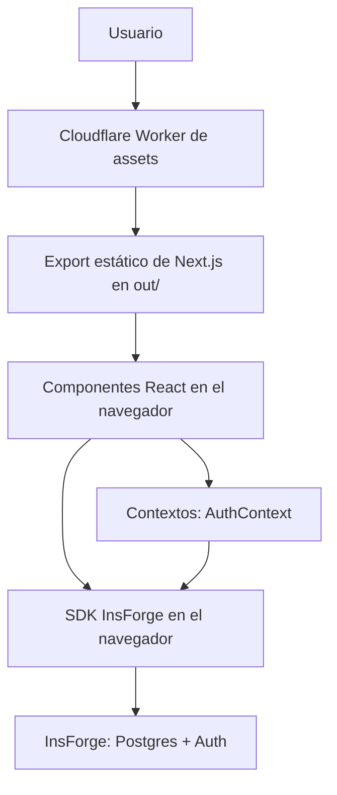

# 🏗️ Arquitectura del Sistema

> Diseño y patrones de TravelPal (repo `app-viajes`).

## Visión general

App web Next.js (App Router) exportada como archivos estáticos y servida por Cloudflare Workers
Assets, con InsForge como backend. En producción no se ejecuta un servidor Next.js: la UI y la
autenticación funcionan en el navegador y el SDK se conecta directamente a InsForge.

### Stack

| Capa | Tecnología | Propósito |
|------|------------|-----------|
| Frontend | Next.js 16.3.8 + React 19 | Framework y UI |
| Lenguaje | TypeScript | Tipado estático |
| Estilos | Tailwind CSS | Diseño responsive |
| Backend | InsForge (`@insforge/sdk`) | Postgres + Auth + Storage |
| Hosting | Cloudflare Workers Assets + Wrangler | Servir el export estático de `out/` |

### Estructura

```
src/
├── app/                  # App Router: páginas y API routes
├── components/           # UI por dominio (trips, notes, planning, ...)
├── contexts/             # AuthContext, ThemeContext
└── lib/
    ├── insforge.ts       # Cliente InsForge del navegador (createInsforgeClient)
    ├── auth.ts           # AuthService; llamadas de auth desde el navegador
    ├── public-env.ts     # Validación de variables públicas (zod)
    └── env.ts            # Validación de secreto para utilidades administrativas locales
migrations/               # Esquema InsForge (fuente de verdad; ver ADR-004)
public/                   # Assets estáticos y sw.js (service worker de push; ver ADR-013)
```

## Flujo de datos

Hay **un único camino** para los datos de usuario: el navegador habla directamente con InsForge por
el SDK. El BFF de `/api/*` se retiró; el porqué y las pérdidas quedan en
[ADR-009](DECISIONS/ADR-009-camino-unico-sdk-en-navegador.md).



En cliente, autenticación y acceso a datos van por `createInsforgeClient()` y el SDK de InsForge.
La autorización la decide **RLS** (`auth.uid() = user_id`), no el Worker: cada usuario ve y toca
sólo sus filas aunque llame al SDK directamente. La agregación y el cálculo viven en las páginas,
no en un servidor de la aplicación.

El **guardián** `scripts/check-data-paths.mjs` (con `scripts/data-paths-baseline.json`) es la valla
que impide volver al BFF: cuenta los `fetch`/`useApiResource` a `/api/<dominio>` y falla el build si
aparece uno nuevo, con literal o con la url en variable. Hoy está en `puntos bff: 0 / 0` y
`sin dominio 0 / 0`.

### Rutas y API

No quedan Route Handlers ni endpoints de Next.js en producción. Las páginas de `src/app/` se
exportan como archivos en `out/`; `/auth/callback` es una página cliente que deja que el SDK
InsForge termine el intercambio OAuth. Las llamadas de datos y auth se hacen directamente desde el
navegador a InsForge.

## Autenticación

- `AuthService` usa `createInsforgeClient()` del SDK en el navegador para registro, login, logout,
  OAuth, restablecimiento y consulta de sesión.
- `/auth/callback` es una ruta estática. El SDK cliente procesa los parámetros del callback y la
  página envía al usuario al dashboard o al acceso según el resultado.
- No hay proxy, Server Actions ni route handlers de auth en el despliegue estático. La sesión y los
  datos privados quedan protegidos por InsForge y sus políticas RLS.

## Modelo de datos

Fuente de verdad única: `migrations/20260913181842_create-app-schema.sql` (ver ADR-004). Deriva de
las consultas reales y usa `text + CHECK` en vez de enums, con RLS de propietario (`auth.uid()`).

Tablas: `trips`, `expenses`, `notes`, `tasks`, `bookings`, `itinerary_activities`, `alerts`,
`budgets`, `journal_entries`, `journal_photos`, `profiles`. Las migraciones posteriores amplían
y corrigen la base; `public.users` se retira en `20260918210000_drop-public-users.sql`. El detalle y el glosario están en [CONTEXT.md](../CONTEXT.md).

## Notificaciones push de navegador

La campana lee las alertas de `alerts` con el SDK. Sobre eso, el cliente registra `public/sw.js` y
ofrece alta/baja de suscripcion push en `/settings` (`src/hooks/usePushNotifications.ts` +
`src/lib/push.ts`), con el permiso pedido solo desde un gesto. **El envio esta bloqueado**: faltan la
tabla `push_subscriptions`, la marca de envio, la edge function de firma y el schedule, que no se
tocan. La suscripcion se refleja en localStorage como puente temporal, no como fuente de verdad (esa
es `pushManager.getSubscription()`). El detalle, el esquema propuesto y el porqué están en
[ADR-013](DECISIONS/ADR-013-push-de-navegador-solo-cliente.md).

## Configuración y entorno

- `src/lib/public-env.ts`: variables `NEXT_PUBLIC_*` (van al bundle del cliente).
- `src/lib/env.ts` valida `INSFORGE_API_KEY` para utilidades administrativas locales; esa clave no
  se incorpora al export ni se configura en el Worker estático.
- `NEXT_PUBLIC_INSFORGE_URL` y `NEXT_PUBLIC_INSFORGE_ANON_KEY` se incorporan al export durante el
  build. La autorización de datos la aplica RLS. Ver [ADR-014](DECISIONS/ADR-014-cloudflare-static-assets-worker.md).

## CI

`.github/workflows/ci.yml` ejecuta en PR: lint, type-check, Jest, prueba RLS, prueba de timezone,
guardián de rutas de datos, export estático, validación del export y build de Storybook. `build`
sube `out/` como artefacto; `worker` (mostrado como `worker-build`) lo descarga, lo valida y corre
`pnpm exec wrangler deploy --dry-run --no-autoconfig`. No compila un Worker OpenNext. `commitlint.yml`
valida los mensajes de commit.

Los E2E de Playwright, Tester Army y Storybook corren contra el export estático en PR y en push a
`main`. En `main`, `deploy` depende de `build`, `worker` y `e2e`, descarga el artefacto y lo publica
con Wrangler; `e2e-produccion` corre después contra el sitio desplegado. Los tests del usuario
dedicado se serializan entre ramas. CI usa Node 22.22.3. GitHub Actions es la única vía automática;
no hay triggers de Cloudflare Workers Builds.
Ver [TESTING.md](TESTING.md) y [TESTER-ARMY.md](TESTER-ARMY.md).

El job `build` ejecuta además `node scripts/check-data-paths.mjs` (etapa 0 del [#38]): cuenta las
llamadas al BFF por `/api` (`fetch` y `useApiResource`) y los puntos de uso del SDK de InsForge
(`.database.from`), y falla si aparece un `fetch` nuevo a un endpoint de datos de usuario. Con el BFF
retirado no queda ningún punto (todo a cero), así que el guardián ya no congela deuda: **prohíbe**
volver a él (ver [ADR-009](DECISIONS/ADR-009-camino-unico-sdk-en-navegador.md)). El baseline por
fichero y por dominio vive en `scripts/data-paths-baseline.json` y se regenera con `--update` al
borrar un endpoint.

[#38]: https://github.com/PabloJustDevelops/TravelPal/issues/38


## Decisiones

Ver `docs/DECISIONS/`: 002 (InsForge), 003 (hosting OpenNext retirado), 004 (esquema desde el modelo TS), 009
(camino único de datos por el SDK), 012 (retirada del código BFF y de `public.users`), 013 (push de
navegador: cliente ya, envío bloqueado), 014 (Worker de assets estáticos). El ADR-001 (adaptador de
sesión sobre Supabase) queda como histórico.
