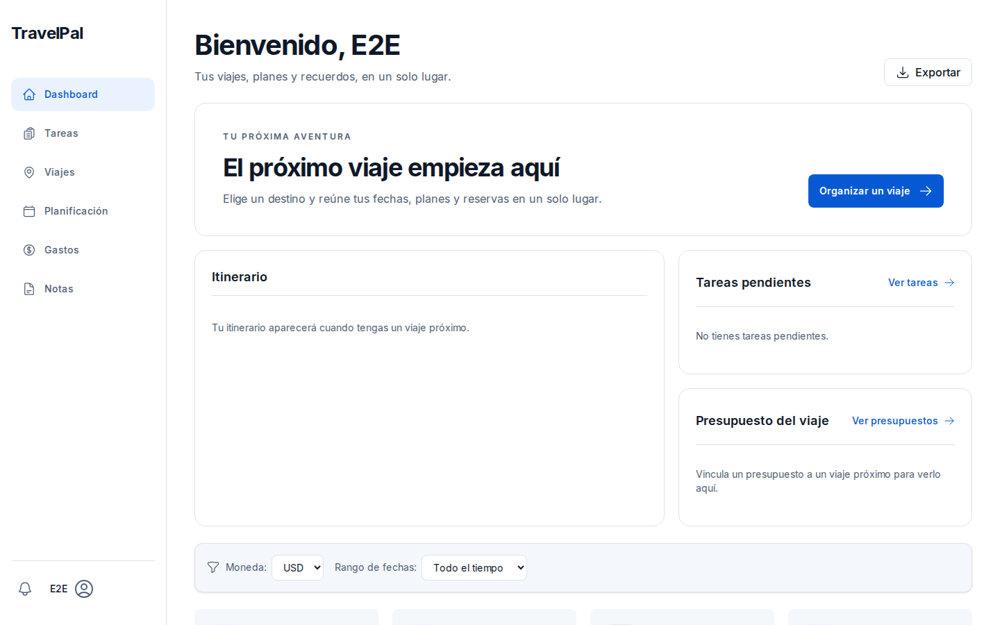
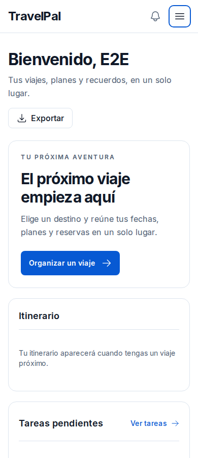
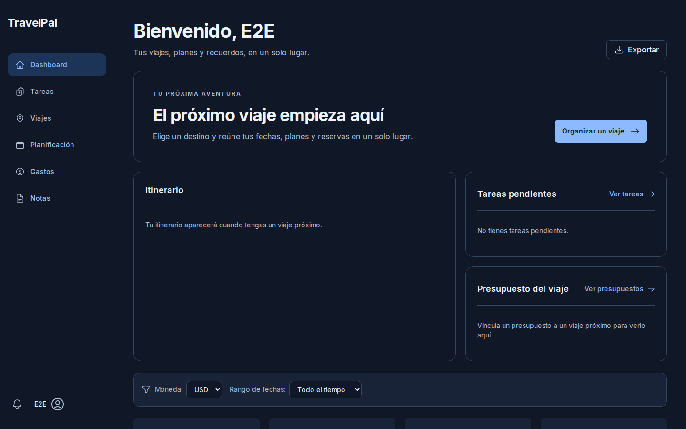
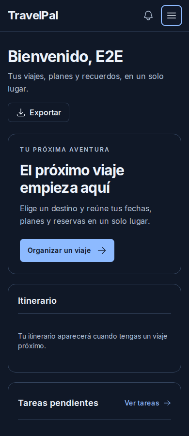
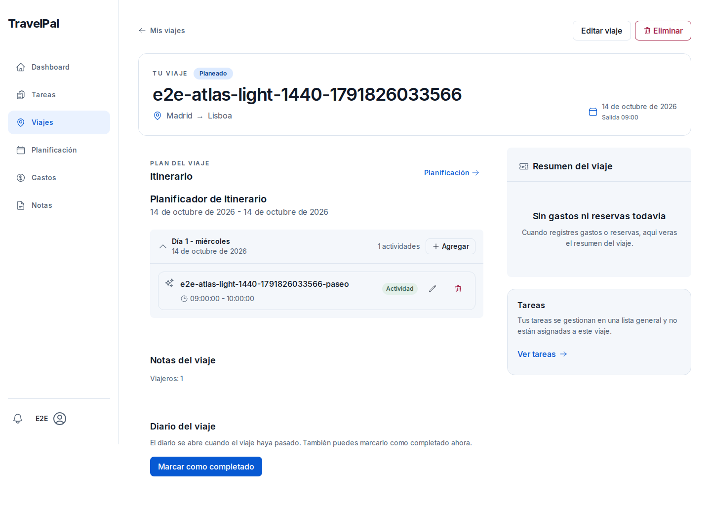
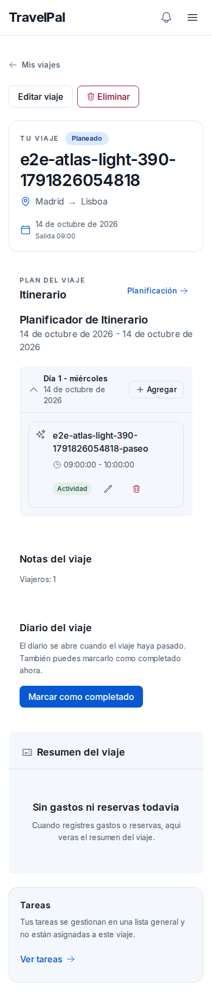
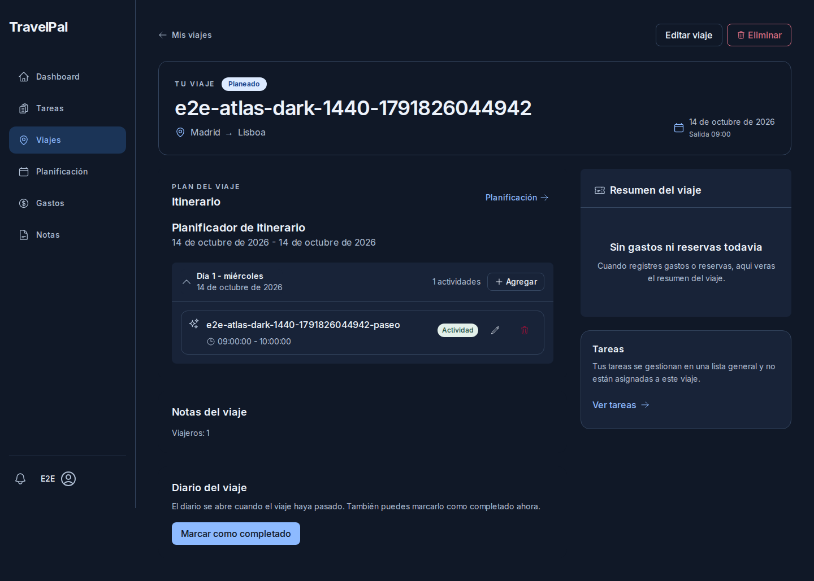
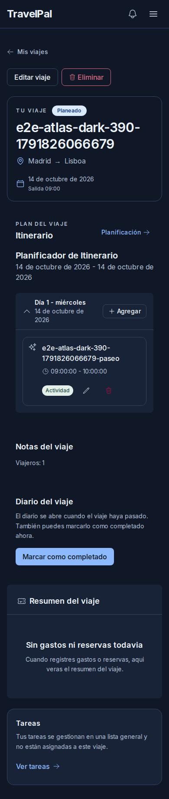

# QA autenticada de Atlas: dashboard y detalle

## Alcance y ejecución

Evidencia nueva del [CI 38283748961](https://github.com/PabloJustDevelops/TravelPal/actions/runs/38283748961), commit `86fa365`, cuenta dedicada E2E, Chromium en Linux. Se descargó el artefacto `atlas-qa-codigo` y se inspeccionaron las ocho PNG originales antes de incorporarlas a este informe. Las credenciales se usaron únicamente dentro del job; no se recuperaron para el entorno local.

La auditoría visual comprende dos pantallas, en claro/oscuro y a 1440/390 px. El dashboard muestra el estado vacío real de la cuenta. El detalle muestra un viaje y una actividad creados por la suite y eliminados por su limpieza. No es una comparación con el boceto de Lisboa poblado ni una auditoría visual de todas las rutas.

## Verificación ejecutada

| Comando en el job | Salida real | Resultado |
| --- | --- | --- |
| `pnpm run test:e2e` | `22 passed (2.8m)` | Paso success, exit 0 |
| `pnpm run test:tester` | `Test Files 2 passed (2)`, `Tests 6 passed (6)` | Paso success, exit 0 |
| `pnpm run test:storybook` | `Test Files 8 passed (8)`, `Tests 32 passed (32)` | Paso success, exit 0 |
| `gh run download 38283748961 --name atlas-qa-codigo --dir /tmp/travelpal-qa-audit-38283748961` | Ocho PNG descargadas | exit 0 |

Los tests de dashboard comprobaron notificaciones, límites del viewport, menú móvil, retorno del foco con Escape, filtros con nombre accesible y axe sobre `nav`/`main`. El detalle comprobó alta, edición, recarga y borrado de actividad, controles de edición/borrado de al menos 44 px y axe sobre `main`. Los formularios autenticados también se ejecutaron en CI. Estos checks no certifican conformidad WCAG, uso de lector de pantalla ni Safari/iOS.

Storybook informó de recursos abiertos al cerrar, aunque el paso terminó correctamente; no se interpreta ese aviso como una validación adicional.

## 1. Dashboard vacío — utilizable, con oportunidad de compactación

La acción principal «Organizar un viaje» es visible, la navegación identifica la sección actual y el contenido conserva la jerarquía en ambos temas. Los textos describen el vacío sin inventar datos. En móvil no hay recortes laterales en el encuadre capturado.

**P2, oportunidad de UX:** en escritorio el bloque vacío de itinerario ocupa una tarjeta de casi 400 px de alto; en móvil los bloques se apilan y el presupuesto queda fuera de los primeros 900 px. Conviene compactar el estado inicial y priorizar una secuencia corta para organizar el primer viaje. No se ha medido abandono ni tiempo de tarea, por lo que esto es una observación de composición.

Capturas viewport, sin recorte ni normalización:

## 2. Detalle con actividad — funcional y responsive, con ajustes de texto

El título largo de prueba se ajusta a la tarjeta móvil. Editar, eliminar y agregar permanecen dentro del ancho; las acciones del itinerario se apilan. El resumen y las tareas explican sus estados reales, incluida la ausencia de asociación de tareas al viaje.

**P3, texto confirmado:** el encabezado muestra «1 actividades» (`src/components/planning/ItineraryPlanner.tsx:294`). Debe usar singular cuando hay una actividad.

**P3, formato confirmado:** la actividad muestra `09:00:00 - 10:00:00`. El adaptador conserva los valores de hora SQL (`src/components/trips/TripItinerary.tsx:44`) y el planner los imprime sin formatear (`src/components/planning/ItineraryPlanner.tsx:356`). Conviene presentar `HH:mm` sin alterar los valores persistidos.

**P3, oportunidad de UX:** «Plan del viaje», «Itinerario» y «Planificador de Itinerario» repiten la misma sección, especialmente en móvil. Una cabecera con fechas reduciría la longitud inicial. La captura no permite valorar el uso con muchos días o muchas actividades.

Capturas full-page con viewport 1440 × 900 o 390 × 900; dimensiones originales 1440 × 1029 y 390 × 1833:

## Regresión de CI encontrada y corregida

El CI anterior falló porque `getByLabel('Contraseña')` encontraba tanto el input como el botón «Mostrar contraseña». Se reprodujo localmente con el formulario real y sin enviar credenciales. El helper compartido usa ahora coincidencia exacta y el smoke autenticado reutiliza ese helper.

La regresión pública `e2e/smoke/signin-controls.spec.ts` falló antes del arreglo (exit 1, strict mode) y pasó después (exit 0). Rellena datos sintéticos sin enviarlos y comprueba mostrar y volver a ocultar la contraseña. Las capturas que antes se perdían en `/tmp` se conservan ahora como artefactos de QA durante siete días, también cuando la suite pasa.

## Pendiente para el gate visual global

1. Preparar un dashboard poblado reproducible desde UI, con viaje vigente, itinerario y presupuesto asociado. Las tareas son globales, sin `trip_id`.
2. Añadir limpieza específica del presupuesto y las tareas de prueba: `deleteTrip` elimina itinerario, pero el presupuesto queda sin viaje y las tareas no se borran. No introducir fixtures que acumulen datos.
3. Comparar el mismo estado poblado con la referencia seleccionada. El modelo `Trip` todavía no tiene fuente de imagen para el hero; no se debe atribuir una foto genérica al destino.
4. Capturar visualmente las demás rutas y estados de error/carga/modal; los E2E funcionales de esta ejecución no sustituyen esas capturas.

Commitlint rechazó el mensaje de `86fa365` por las mayúsculas E2E/QA. Pablo autorizó corregir únicamente el mensaje el 13 de octubre. Se sustituyó por `265d683` y `git diff --exit-code 86fa365 HEAD` confirmó, con exit 0 y sin salida, que su contenido no cambió. El workflow funcional citado corresponde al commit original y terminó con success.

## Ajustes posteriores: 13 de octubre

Se corrigieron los dos defectos de texto identificados en el detalle: singular para una actividad y presentación `HH:mm` para horas SQL. El recorte a minutos se aplica al texto visible; no modifica los valores del formulario ni la persistencia. Las capturas anteriores permanecen como evidencia del estado auditado antes del arreglo.

La nueva prueba del planificador real reprodujo ambos fallos antes del cambio: `pnpm exec jest --runInBand --coverage=false src/components/planning/__tests__/ItineraryPlanner.test.tsx` devolvió exit 1, con 2 pruebas fallidas y 2 aprobadas. Tras el arreglo:

| Comando local | Salida real | Código |
| --- | --- | --- |
| `pnpm exec jest --runInBand --coverage=false src/components/planning/__tests__/ItineraryPlanner.test.tsx src/components/trips/__tests__/TripItinerary.test.tsx` | 2 suites, 10 pruebas aprobadas | 0 |
| `pnpm exec jest --runInBand --coverage=false` | 61 suites, 446 pruebas aprobadas | 0 |
| `pnpm exec eslint src/components/planning/ItineraryPlanner.tsx src/components/planning/__tests__/ItineraryPlanner.test.tsx` | Sin diagnósticos | 0 |
| `pnpm run type-check` | `tsc --noEmit`, sin diagnósticos | 0 |
| `pnpm build` | Next.js 16.3.8, compilación y generación de rutas correctas | 0 |

La revisión independiente del parche devolvió «Sin hallazgos». Los consumidores del planificador (`TripItinerary` y `/planning`) normalizan las horas ausentes a una cadena vacía. La captura del dashboard poblado y la comparación global siguen pendientes. La compactación del estado vacío quedó verificada el 13 de octubre (detalle abajo).

## Compactación del dashboard vacío — 13 de octubre

La tarjeta de itinerario se estiraba hasta la altura combinada de las tarjetas de tareas y presupuesto: Storybook midió 398 px en estado vacío. Se alinea ahora al inicio de la fila y reduce su espacio vertical. El test de la historia `Empty` verifica una altura menor de 220 px; el navegador midió 139 px a 1440 px de ancho y 151 px a 390 px. Capturas aisladas del componente: `../qa/audits/assets/11-dashboard-vacio-compacto-escritorio.png` y `../qa/audits/assets/12-dashboard-vacio-compacto-movil.png`.

Esto resuelve la tarjeta vacía alta. No reemplaza la captura autenticada ni la comparación del dashboard poblado contra la referencia, que siguen pendientes.
