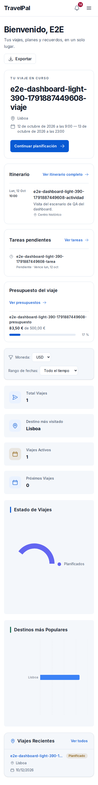
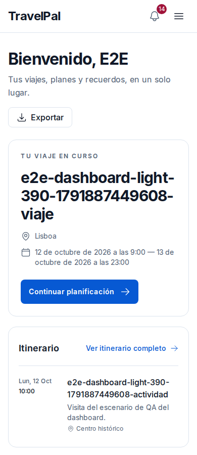
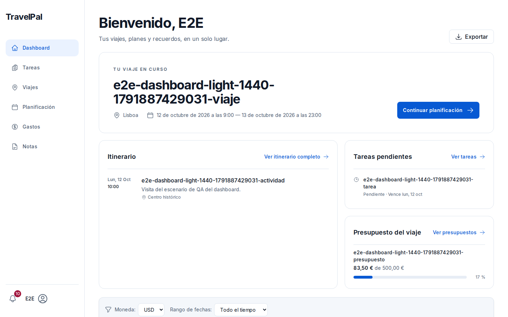
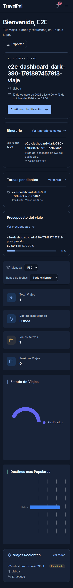
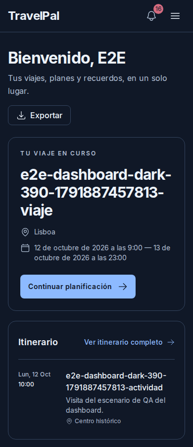
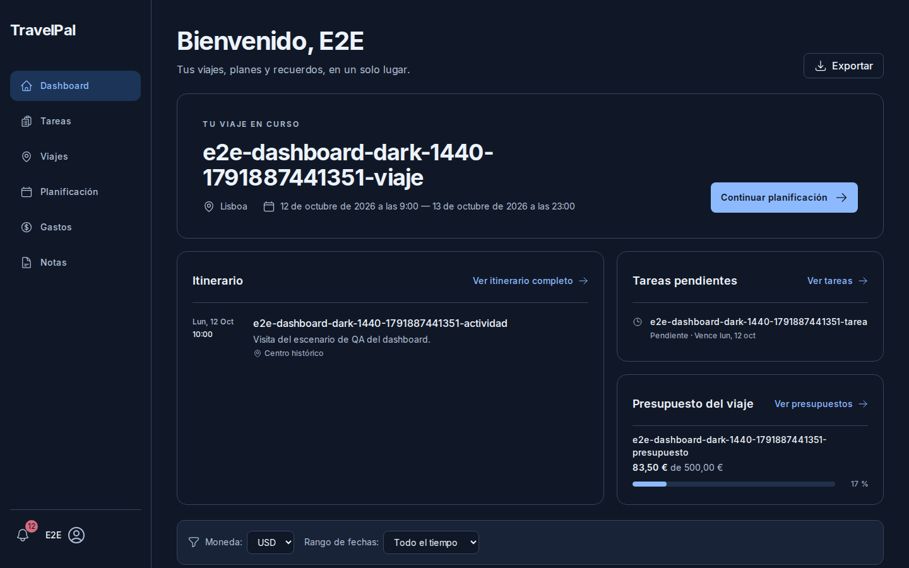

# QA de fidelidad visual — dashboard y acceso (fase 1)

## Alcance y evidencia

Revisión del dashboard poblado en escritorio y móvil, tema claro y oscuro, y de las pantallas públicas locales de acceso, registro y recuperación. Se contrastó la composición con la referencia seleccionada en [`docs/design/atlas-reference.png`](../design/atlas-reference.png) y con la dirección Atlas de [`docs/design/2026-10-10-ui-qa-spec.md`](../design/2026-10-10-ui-qa-spec.md).

Las seis capturas autenticadas se generaron en CI para el commit `4ffb33d0209fe736e2c255f4cdf624f6ca684c40` (run [38383426671](https://github.com/PabloJustDevelops/TravelPal/actions/runs/38383426671)), con la cuenta de E2E, datos sintéticos y limpieza de fixture. Se descargaron e inspeccionaron los PNG originales. Tamaños: viewport 390 × 900 y 1440 × 900; full-page móvil 390 × 3100. `/signin`, `/signup` y `/forgot-password` se abrieron localmente el 13 de octubre con InsForge ficticio y sin enviar formularios; `/dashboard` redirigió a `/signin?redirectTo=%2Fdashboard`, por lo que esa sesión no aporta evidencia autenticada.

## Verificación relacionada

El workflow CI del commit `4ffb33d` terminó en success. En sus logs constan `26 passed` para Playwright, `Test Files 2 passed (2)` y `Tests 6 passed (6)` para Tester Army, y `Test Files 8 passed (8)` / `Tests 32 passed (32)` para Storybook. El test poblado incluye comprobación de `scrollWidth <= innerWidth` y axe sobre `nav` y `main` en las cuatro combinaciones de tema y anchura. Esto acredita esos criterios automatizados para el escenario y navegador del CI; no certifica WCAG, Safari/iOS ni el uso con lector de pantalla.

## Hallazgos

### P1 — El acceso mezcla el tema oscuro con una página clara

En las capturas locales de `/signin`, `/signup` y `/forgot-password`, el fondo y la columna del formulario fuerzan fondos claros, mientras los campos consumen `bg-paper` y `text-ink`. Con la clase `.dark` aplicada al documento, los tres flujos muestran inputs azul marino sobre fondo blanco. El botón de Google de acceso y registro también hereda texto claro sobre fondo transparente, con contraste visual insuficiente. El origen está en la combinación de estilos fijos de [`src/app/signin/page.tsx`](../../src/app/signin/page.tsx), [`src/app/signup/page.tsx`](../../src/app/signup/page.tsx), [`src/app/forgot-password/page.tsx`](../../src/app/forgot-password/page.tsx) y tokens de [`src/components/ui/fieldStyles.ts`](../../src/components/ui/fieldStyles.ts); no se ha cambiado código en esta fase.

**Recomendación:** migrar la composición de acceso a tokens semánticos (`paper`, `surface`, `ink`, `muted`, `line`) y validar una matriz clara/oscura de 390/1440 px con axe y capturas. Conservar la fotografía de viaje solo en claro si el contraste del texto y el objetivo visual se mantienen; en oscuro, usar una superficie de marca coherente.

### P1 — Las gráficas móviles consumen demasiado alto para la información que muestran

En el full-page móvil poblado, las gráficas ocupan 300–350 px cada una, además del encabezado y el padding de la tarjeta. El gráfico de estado muestra una sola categoría y el de destinos una sola barra, con áreas vacías grandes. Después de los bloques de viaje, itinerario, tareas y presupuesto, esto alarga el dashboard sin aportar una lectura proporcional.

**Recomendación:** reducir la altura en móvil, optimizar el donut/leyenda para una columna estrecha y definir una altura de barra según cantidad de datos. Mantener el tamaño actual en escritorio hasta validar el equilibrio con datos más variados.

### P2 — La referencia y el producto coinciden en jerarquía, pero no en el tratamiento del viaje

La aplicación ya antepone viaje actual, itinerario, tareas y presupuesto, y conserva navegación lateral en escritorio y menú en móvil. La referencia seleccionada agrupa esos bloques en una portada visual con un gran protagonista de destino; la implementación usa una tarjeta blanca delimitada y deja las métricas/gráficas en una columna larga.

El modelo `Trip` no ofrece una imagen validada del destino. Por tanto, no se recomienda rellenar la diferencia con una fotografía genérica. La mejora debe centrarse en proporción, jerarquía tipográfica y composición con información disponible hasta que exista un origen de imagen aprobado.

### P2 — La comparación visual usa nombres de fixture deliberadamente largos

Los títulos visibles `e2e-dashboard-…` se generan únicos para cada ejecución y se parten en varias líneas. Comprueban que no haya desbordamiento, pero dificultan juzgar la composición real y exageran la altura del bloque de viaje. Para la siguiente ronda conviene conservar el sufijo de unicidad en los datos y mostrar un título corto de viaje/actividad/tarea en las capturas.

## Evidencia visual adicional

## Orden recomendado para la siguiente iteración

1. Corregir tema y contraste de todos los formularios de acceso, y cubrir claro/oscuro.
2. Compactar gráficas del dashboard en móvil y verificar con varios datos, vacío y axe.
3. Acortar los títulos de fixture sin perder aislamiento/limpieza y revisar visualmente el estado representativo.
4. Repetir capturas a 390/1440, revisar las diferencias con la referencia y después continuar la auditoría por viajes, planificación, tareas, gastos, notas y perfil.

Esta es la primera entrega de la auditoría visual global: cubre dashboard y acceso, y conserva como referencias las auditorías de detalle de viaje y planificación ya existentes. No cubre todavía, con capturas actuales, viajes, tareas, gastos, notas y perfil; tampoco fusiona PRs ni da por terminado el rediseño. La observación local autenticada sigue limitada por la ausencia de credenciales de QA en este entorno; las pantallas protegidas de esta fase se observaron en las capturas actuales del CI.
